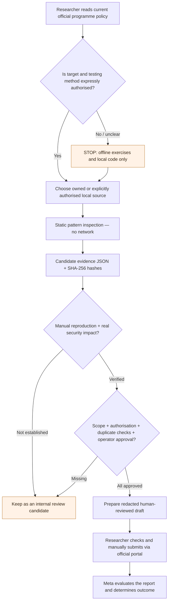
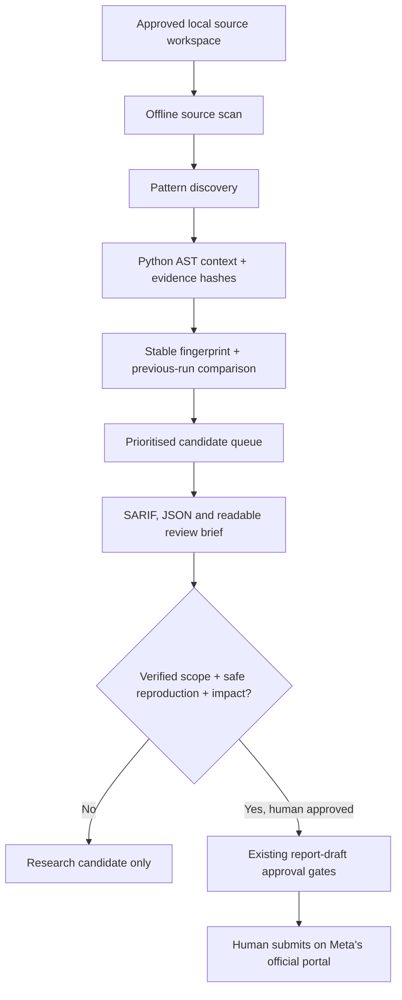

<div align="center">

# Meta Bug Bounty Research Pipeline

**Offline-first vulnerability research • Verifiable evidence • Human-approved reporting**

[](https://www.python.org/)
[](https://github.com/HillaryMurimi/meta-bounty-research-pipeline/actions/workflows/tests.yml)
[](LICENSE)
[](examples/meta-policy.json)

*A community research organiser — not affiliated with, sponsored by, or endorsed by Meta.*

</div>

> [!IMPORTANT]
> **No Meta systems are probed by the Meta workflow.** The default policy has `scope_status: unverified`, `network_access: false`, `live_testing_approved: false` and `auto_submit: false`. Findings are **local static-analysis candidates**, not demonstrated vulnerabilities, reward eligibility or guaranteed income. Never publish confidential findings in this public repository.

## What this repository is

A small, dependency-free Python toolkit to help a researcher handle the **administrative and evidence-management work** of security research, without skipping authorisation, validation or responsible disclosure. It was developed as a practical, beginner-accessible starting point for Meta-related research. The tool does **not** perform autonomous vulnerability exploitation, live Meta scanning, web scraping or automatic bug bounty submission.

### At a glance

| Component | What it does | What it does **not** do |
| --- | --- | --- |
| `meta_workflow.py inspect` | Reads **local** Python/JS/TS source and flags patterns worth reviewing | Execute code, connect to Meta, prove exploitability |
| Evidence export | Produces structured JSON with file/line SHA-256 hashes and rule identifiers | Save raw secret-containing source lines |
| `meta_workflow.py draft` | Builds a draft after six human approval gates and substantive review fields | Submit, verify that approvals are truthful, establish reward eligibility |
| `bounty.py` (legacy generic demo) | Demonstrates a separately gated, headers-only check against explicitly authorised HTTPS URLs | Authorise testing Meta; assess vulnerabilities conclusively |
| `tests/` | Runs deterministic fixtures and verifies that safety gates block unapproved work | Validate findings on production assets |

## How the workflow works



**Important distinction:** completing a local inspection never grants permission for production testing. A public GitHub repository is not automatically eligible for a Meta bounty.

## Quick start — Windows PowerShell

**Prerequisites:** Windows 10/11 (or macOS/Linux), Python **3.11+**, Git. The Meta workflow uses only Python's standard library.

```powershell
# 1. Get the public repository
 git clone https://github.com/HillaryMurimi/meta-bounty-research-pipeline.git
 cd meta-bounty-research-pipeline

# 2. Prove the gates work: the test suite makes no Meta requests
 python -m unittest discover -s tests -v

# 3. Inspect only the included synthetic example
 python meta_workflow.py inspect `
   --policy examples/meta-policy.json `
   --workspace examples/local-fixture `
   --output out/meta-evidence.json

# 4. Review the generated evidence JSON locally
 Get-Content out/meta-evidence.json
```

The example is **deliberately synthetic**. You should see a single candidate called `python_dynamic_execution`, with `confirmed_vulnerability: false`. The programme scope remains `unverified`; `network_requests` is always `0` for this workflow.

### What an evidence record looks like

```json
{
  "finding_id": "R0001",
  "rule_id": "PY-EXEC",
  "kind": "python_dynamic_execution",
  "path": "demo.py",
  "line": 4,
  "file_sha256": "<64-character hash calculated at run time>",
  "line_sha256": "<64-character hash calculated at run time>",
  "status": "needs_manual_validation",
  "confirmed_vulnerability": false,
  "evidence_type": "local_source_code_pattern"
}
```

*Illustrative schema only: line numbers and hashes depend on the exact files scanned.*

## Step-by-step: from candidate to report

**1. Select a legitimate local workspace.** Use the included fixture or code you own / have permission to inspect. The scanner recognises `.py`, `.js`, `.jsx`, `.ts` and `.tsx`, skips common build directories and symlinks, caps each file at 1 MB, and limits a run to 1,500 considered files. It **does not execute code**.

**2. Inspect the candidate as a hypothesis.** Example rule families include dynamic execution, shell invocation, disabled TLS verification, deserialisation and HTML sinks. A pattern match may be perfectly safe because of input validation, context or unreachable code. Do not send pattern-only reports to Meta.

**3. Preserve and protect evidence.** The JSON captures source-file hashes, candidate line hashes, rule identifiers and precise local locations. Review the output before sharing. Keep real proof-of-concepts, sensitive material and researcher credentials **outside** this public Git repository.

**4. Reproduce locally with an authorised, non-destructive test.** Establish the precise trust boundary, expected behaviour, observed behaviour and actual security impact. Do not validate against Meta production unless the current rules explicitly authorise the exact testing method and target.

**5. Check Meta scope and duplicates.** Verify eligible products and exclusions against the authenticated official programme policy, document that review privately, and check whether the issue is known or already reported. A failed public-search result does not prove that a report is novel.

**6. Use the human approval gate.** Copy the template to a **private, untracked** location, provide substantive written evidence, and truthfully approve all six controls:

```text
meta_scope_verified
explicit_test_authorisation_verified
manual_reproduction_confirmed
real_security_impact_confirmed
nonduplicate_reviewed
operator_approved_report
```

The template defaults to all `false`. **Do not set these fields to `true` merely to make the command succeed.**

```powershell
# Only after genuine verification and a complete private review:
python meta_workflow.py draft `
  --evidence out/meta-evidence.json `
  --review my-approved-review.json `
  --finding R0001 `
  --output out/approved-draft.md
```

Unapproved or poorly substantiated reviews are **rejected by design**. A generated draft still needs redaction, checking and **manual submission through the official Meta portal**.

## Research safety model

| Boundary | Enforcement / expectation |
| --- | --- |
| Meta production network | Disabled in `meta_workflow.py`; inspection only reads local source |
| Policy status | Example is always **unverified**; cannot flip it to approved in this starter |
| Reports | Six human booleans plus written proof and review required |
| Source content | Raw matched lines are not copied into evidence JSON; hashes are computed locally |
| Secrets & personal data | Must never be committed; GitHub is **public** |
| Generic `bounty.py` | Separate legacy demonstrator; it has an explicit execution flag, allowlist and rate cap, **not permission to test Meta** |
| Responsible disclosure | Share genuine vulnerabilities only with the affected programme via its designated channel |

Read [SECURITY.md](SECURITY.md) before using the tools on real-world material. The scanner performs **limited heuristic inspection**, not vulnerability assessment or formal security assurance.

## Meta programme notes and sources

- [Official Meta Bug Bounty portal](https://bugbounty.meta.com/) — **source of truth** for current scope, rules and submissions. Some current terms may require sign-in; we have **not** certified the complete November 2026 policy.
- [Meta statement on scraping-related research (2021)](https://about.fb.com/news/2021/12/expanding-bug-bounty-program-to-address-scraping/) — explicitly distinguished research eligibility from permission for automated collection. This is historical background, **not a substitute for current policy**.
- [Zurp research toolkit](https://github.com/facebookincubator/Zurp) — certain capabilities require researcher eligibility and platform-granted credentials. None are bundled here.

There is **no** claim that a public Meta API, repository, site or data set can be legally scanned simply because it exists.

## Repository structure

```text
meta-bounty-research-pipeline/
├── README.md                     ← detailed documentation and diagrams
├── meta_workflow.py              ← offline Meta research and report gates
├── bounty.py                     ← optional, unrelated generic scoped demo
├── examples/
│   ├── meta-policy.json          ← network=false, approvals=false
│   ├── program.template.json     ← generic example; NOT a Meta scope list
│   ├── review.template.json      ← six gates all false
│   └── local-fixture/demo.py     ← synthetic unsafe-pattern sample
├── tests/
│   ├── test_meta_workflow.py
│   └── test_bounty.py
├── .github/workflows/tests.yml   ← enabled CI on main (offline-only)
├── docs/ci/tests.yml.example     ← reference copy of CI template
├── SECURITY.md                   ← responsible disclosure and privacy
├── CONTRIBUTING.md               ← contribution and branch discipline
├── LICENSE                       ← MIT licence
└── .gitignore                    ← generated outputs / private reviews excluded
```

## Development, CI and branch policy

The repository's only intended long-lived branch is **`main`**. The maintainer commits and pushes directly to `main`; no additional branches are created as part of this setup. GitHub Actions is **enabled** in `.github/workflows/tests.yml` and runs the offline Python test suite on pushes to `main` across Python 3.11, 3.12 and 3.13. It never contacts Meta or executes live target scans. The reference template remains under `docs/ci/tests.yml.example`. **Nine tests have been confirmed locally**; check the badge or Actions page for the latest hosted CI result rather than assuming CI passed.

```powershell
python -m unittest discover -s tests -v
python -m py_compile meta_workflow.py bounty.py
# Maintainer workflow, after code review:
git status --short
git add .
git commit -m "Describe the change"
git push origin main
```

Read [CONTRIBUTING.md](CONTRIBUTING.md) for review expectations. A passing test suite is not proof that the code is safe for unauthorised deployment or that a reported issue is valid.

## Planned improvements

| Priority | Enhancement | Gate |
| --- | --- | --- |
| P1 | Better local source parsers, suppression annotations, reviewed tests | Offline only |
| P1 | Candidate deduplication and evidence schema versioning | No secrets in exports |
| P2 | Privately stored researcher approvals and signed review metadata | Human approval maintained |
| P2 | Local demonstration applications for authentication / access control | Owned test environment |
| P3 | Optional eligible-platform integrations | Verify current programme rules and explicit permission first |

## Disclaimer

This is an independent educational research utility. It does not perform live Meta vulnerability discovery and offers **no promise of acceptance, rewards or payment**. The researcher is responsible for scope compliance, privacy, lawful testing, validation, safe evidence handling and truthful disclosure. Meta alone determines bounty eligibility and payouts.

---

## Autonomous offline research engine (next phase)

> [!CAUTION]
> **Autonomous does not mean permitted to attack Meta.** This engine only inspects files in an explicitly selected **local workspace**. It cannot independently certify Meta scope, exploitability or bounty eligibility. Live Meta scanning, account interactions, automated data collection, exploit execution and automatic submissions are **not implemented**.

### How the engine operates



**Automated:** bounded source enumeration, SHA-256 evidence provenance, conservative source-pattern detection, Python AST function-context extraction, deterministic priority ordering, stable candidate fingerprints, new/unchanged/resolved-or-moved comparisons, SARIF 2.1.0 export and a human-readable review queue.

**Not automated:** real vulnerability confirmation, source-to-sink exploitability proof, target eligibility, live penetration testing, access to restricted Meta researcher APIs, severity assignment, report submission or payment.

### Run the autonomous pipeline

Open **PowerShell** in the repository's directory:

```powershell
python -m unittest discover -s tests -v

# Demonstrate locally: the source is synthetic.
python autonomous_hunter.py `
  --policy examples/meta-policy.json `
  --workspace examples/local-fixture `
  --output out/research
```

Expected artifacts, stored locally under the ignored `out/` directory:

| Output | Purpose |
| --- | --- |
| `out/research/queue.json` | Machine-readable provenance, review priority, fingerprints, AST context and zero-confirmation flags |
| `out/research/findings.sarif` | SARIF 2.1.0 static analysis results with `note` severity; useful in compatible code review tooling |
| `out/research/REVIEW_QUEUE.md` | Human-readable table and validation checklist |

Compare with the **previous saved run** (store the previous queue outside the new output folder):

```powershell
Copy-Item out/research/queue.json out/previous-queue.json
python autonomous_hunter.py `
  --policy examples/meta-policy.json `
  --workspace examples/local-fixture `
  --previous out/previous-queue.json `
  --output out/research
```

For a separate repository that you **own or are authorised to examine**, replace `--workspace` with its local path. The scanner does **not** download, clone, execute or contact the examined source. Large files, build directories, dependency trees, and symlinks are excluded. The review queue may contain false positives; patterns are *not* validated vulnerabilities.

### Interpreting the prioritised review queue

The numerical `review_priority` is a **sorting heuristic**, not CVSS, exploit probability, award amount or evidence of exploitability.

```json
{
  "rule_id": "PY-EXEC",
  "classification": "investigation_candidate_not_proven",
  "review_priority": 75,
  "context": {
    "analysis": "python_ast",
    "scope": "function",
    "taint_proof": false
  },
  "requires_human_reproduction": true,
  "confirmed_vulnerability": false
}
```

A local `eval` occurrence is a **lead**, not a finding. Before reporting, independently establish a reachable attacker-controlled input, an actual security boundary, a harmless reproduction and demonstrable impact, then verify Meta's current reward scope and exclusions.

### Why the automation cannot promise bounties

Meta decides whether an issue is novel, in scope, reproducible, impactful and eligible for a reward. Even a demonstrated code weakness in a public repository can be non-eligible. High-volume speculative or AI-generated reports can waste triage time. Do not send the contents of `queue.json` directly to Meta.

### Meta research policy links and access boundaries

- [Official Meta bug bounty portal](https://bugbounty.meta.com/) — read **current** scope and exclusions before any live work.
- [Meta on scraping-related bounty research](https://about.fb.com/news/2021/12/expanding-bug-bounty-program-to-address-scraping/) — Meta states that its terms do not generally allow automated access and collection of data.
- [Meta's Zurp tooling](https://github.com/facebookincubator/Zurp) — an official researcher toolset with capabilities intended for vetted Meta Bug Bounty participants; do not assume unrestricted eligibility or API access.

Meta's terms and the availability of researcher privileges may change. The `examples/meta-policy.json` gate deliberately remains **unverified**, even after any human reads the programme rules; it is not a replacement for written, current authorisation.

### Operational security

All research outputs remain ignored by Git by default. Never commit credentials, access tokens, private bounty details, personal data or unpatched vulnerability reproduction details to this public repository. Use separate private local storage for sensitive evidence and submit privately via the official portal.

### Milestones

1. **Complete:** offline autonomous static triage, stable fingerprints, JSON/SARIF evidence, test coverage and manual approval gates.
2. **Next:** independently evaluated semantic analysis with explicit source-to-sink data-flow checks, stronger deduplication and reproducibility fixtures.
3. **Conditional:** integrate Meta-sanctioned researcher APIs *only if* eligibility and permission are verified.
4. **Conditional:** conduct narrowly scoped manual or automation-assisted live tests *only* where the published terms expressly permit the method.
5. **Never automated by default:** live exploitation, access to third-party user data, disclosure without approval or unreviewed report submission.
